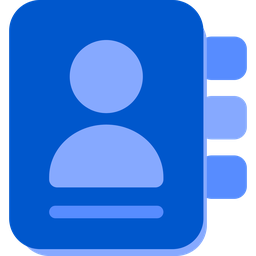

# Advanced Google Contacts (Home Assistant Custom Integration)

Domain: `advanced_google_contacts` · Version: 0.2.0 · Ursprünglich als `google_contacts_basedog` 4.7.0 aus der laufenden HA-Installation übernommen.

## Zweck

Die Integration verbindet Home Assistant per OAuth2 mit der **Google People API** (nur Lesezugriff auf Kontakte) und bietet zwei Funktionen:

1. **Geburtstags-Sync** (Dienst `advanced_google_contacts.sync_birthdays_from_google_contacts`):
   Die Geburtstage aller Kontakte werden als ganztägige Termine in einen beschreibbaren HA-Kalender geschrieben.
2. **Kontakt-Entitäten** (optional): Für jeden Kontakt entsteht ein Gerät mit einem Sensor pro befülltem Kontaktfeld.

## Installation über HACS

1. HACS → ⋮ → *Benutzerdefinierte Repositories* → URL `https://github.com/gbasedow/advanced_google_contacts`, Typ **Integration**.
2. „Advanced Google Contacts“ herunterladen und Home Assistant neu starten.
3. *Einstellungen → Geräte & Dienste → Integration hinzufügen → Advanced Google Contacts*.

## Neue Version veröffentlichen

1. In `custom_components/advanced_google_contacts/manifest.json` die `version` erhöhen (Format `X.Y.Z`).
2. Im Changelog `custom_components/advanced_google_contacts/README.md` einen Abschnitt `## X.Y.Z – …` ergänzen. Sein Text wird zum Release-Text.
3. Nach `main` bringen, direkt oder per Pull Request.

Die Action **Release** legt dann automatisch den Release `vX.Y.Z` an, und HACS bietet das Update an.
Sie bricht ab, wenn der Changelog-Abschnitt fehlt oder die Version niedriger ist als der letzte Release.
Gibt es den Release schon, tut sie nichts. Manuell lässt sie sich über *Actions → Release → Run workflow* starten.
Die Action **Validate** prüft bei jedem Push und Pull Request die Version, den Changelog, die Python-Syntax, hassfest und die HACS-Struktur.

## Umstieg von `google_contacts_basedog` (≤ 4.7) auf `advanced_google_contacts` (0.1)

Durch die neue Domain ist es für Home Assistant eine **neue Integration**. Der alte Eintrag wird nicht übernommen.

1. In HA die alte Integration „Google Contacts Basedog“ löschen.
2. `/config/custom_components/google_contacts_basedog` entfernen, `custom_components/advanced_google_contacts` kopieren und HA neu starten.
3. Unter *Einstellungen → Anwendungs-Anmeldeinformationen* die Google-OAuth-Client-ID und das Secret für „Advanced Google Contacts“ eintragen. Die alten gehören zur alten Domain.
4. Die Integration „Advanced Google Contacts“ hinzufügen und mit Google anmelden. Danach bei Bedarf die Option für Kontakt-Entitäten setzen.
5. In Automationen den Dienst auf `advanced_google_contacts.sync_birthdays_from_google_contacts` umstellen.

Bereits angelegte Geburtstagstermine bleiben gültig, weil der Sync sie am Titel erkennt.

## Einrichtung

- Voraussetzungen: `application_credentials` (Google OAuth-Client vom Typ „Webanwendung“, People API aktiviert, Redirect-URI `https://my.home-assistant.io/redirect/oauth`) und `calendar`.
- Scopes: `contacts.readonly openid email`, mit `access_type=offline` und `prompt=consent`, damit ein Refresh-Token ausgestellt wird.
- Es ist nur **ein** Konto erlaubt (`single_instance_allowed`).
- Beim Start wird die E-Mail-Adresse des Kontos über OpenID UserInfo ermittelt und als Titel des Eintrags gesetzt. Bei 401/403 startet HA automatisch die Reauthentifizierung (`ConfigEntryAuthFailed`).
- Option `create_contact_entities` (Standard im Code: ein): Eine Änderung lädt den Eintrag neu (`OptionsFlowWithReload`).

## Aufbau

| Datei | Aufgabe |
|---|---|
| `manifest.json` | Metadaten, Abhängigkeiten `application_credentials` und `calendar`, `cloud_polling` |
| `const.py` | OAuth-/API-URLs, abgefragte `personFields`, Feldliste und deutsche Feldnamen für die Entitäten |
| `application_credentials.py` | Google-Autorisierungs- und Token-Endpunkt |
| `config_flow.py` | OAuth2-Flow, Reauth und Options-Flow (Kontakt-Entitäten ein/aus) |
| `api.py` | `account_email()` über UserInfo; `contacts()` lädt alle Kontakte seitenweise (1000 pro Seite) und überspringt gelöschte. Ergebnis: Dict `resourceName → Kontakt` mit `display_name`. |
| `coordinator.py` | `DataUpdateCoordinator`. Abruf alle **30 Minuten** nur bei aktivierten Kontakt-Entitäten, sonst nur beim Start und beim Sync. 401/403 → Reauth, andere Fehler → `UpdateFailed` |
| `__init__.py` | Setup und Unload, Registrierung des Dienstes, Aufräumen der Registry, wenn Entitäten deaktiviert sind |
| `sensor.py` | Ein Gerät pro Kontakt, ein Sensor pro befülltem Feld (der Name immer). Zustand = erster Wert (max. 255 Zeichen), Attribut `values` = alle Rohwerte. Neue Kontakte werden dynamisch ergänzt. |
| `birthday_sync.py` | Logik des Geburtstags-Syncs (siehe unten) |
| `services.yaml`, `strings.json`, `translations/` | Dienstbeschreibung und UI-Texte (de/en) |
| `brand/` | Icon und Logo (`icon.png` 256², `icon@2x.png` 512², `logo.png`, `logo@2x.png`); von HA ab 2026.3 genutzt |

## Ablauf des Geburtstags-Syncs

Parameter: `calendar` (`calendar.*`, muss Termine anlegen können; zum Aufräumen auch löschen) und `months` (1–120).

1. Prüfen, ob der Kalender existiert und `CREATE_EVENT` unterstützt. Dann die Kontakte **frisch** bei Google laden.
   Scheitert das, oder liefert Google keine Kontakte, bricht der Sync ab, ohne den Kalender zu ändern.
   Bei abgelaufener Anmeldung startet zusätzlich die Reauthentifizierung.
2. **Soll-Liste** für den Zeitraum heute bis heute + `months` erstellen. Schlüssel ist *(Anzeigename, Datum)*, der Titel lautet
   `Geburtstag <Name> - <Alter>`, bzw. `Geburtstag <Name>`, wenn das Geburtsjahr fehlt.
   Wer am 29.02. Geburtstag hat, bekommt den Termin in Nicht-Schaltjahren am 28.02.
3. **Anlegen:** Termine aus der Soll-Liste, die im Kalender noch nicht exakt so stehen, werden angelegt
   (ganztägig, Beschreibung „Synchronisiert aus Advanced Google Contacts“).
4. **Kontrolllesen:** Fehlt danach ein Soll-Termin, bricht der Sync ab, **ohne etwas zu löschen**.
5. **Aufräumen:** Betrachtet werden nur Termine, die der Sync selbst angelegt hat: Titel `^Geburtstag <Name>( - <Zahl>)?$` **und**
   Beschreibung „Synchronisiert aus Advanced Google Contacts“ oder die alte „… Google Contacts Basedog“.
   Passt so ein Termin nicht genau zu einem Soll-Termin, wird er über seine UID gelöscht. Das betrifft Duplikate, veraltete Alter und umbenannte oder gelöschte Kontakte.
   Von Hand angelegte Termine bleiben immer unangetastet.
6. **Abschlussprüfung:** Jeder Soll-Termin muss genau einmal vorhanden sein.
7. Rückgabe: `{desired, created, deleted, unchanged}`.

Im Einsatz: Die Automation „Geburtstage in Kalender eintragen“ läuft täglich um 01:00 mit `calendar.geburtstage` und `months: 24`.

## Hinweise aus der Code-Analyse

Bereits behoben: veraltete Registry-API, Sync mit veralteten Daten, Löschen fremder Termine, unnötiges Polling,
deutscher Text in `en.json`.

Noch offen:

- **Von Hand angelegte Termine mit gleichem Titel** werden nicht gelöscht. Neben ihnen legt der Sync aber einen eigenen Termin an, sodass er doppelt erscheint.
- Der Zielkalender muss die Terminbeschreibung beim Lesen zurückgeben. Sonst bricht der Sync mit einer Fehlermeldung ab, ohne etwas zu löschen.
- **Identität = Anzeigename:** Haben zwei Kontakte denselben Namen und denselben Geburtstag, entsteht nur ein Termin.
  Liefert Google für einen Kontakt mehrere Geburtstagsangaben (z. B. einmal mit und einmal ohne Jahr), gewinnt die zuletzt gelesene.
  Der Titel mit Alter ist also nicht garantiert.
- **Gelöschte Kontakte** hinterlassen bei aktivierten Entitäten Sensoren, die auf „nicht verfügbar“ stehen. Ihre Geräte werden nicht automatisch entfernt.
